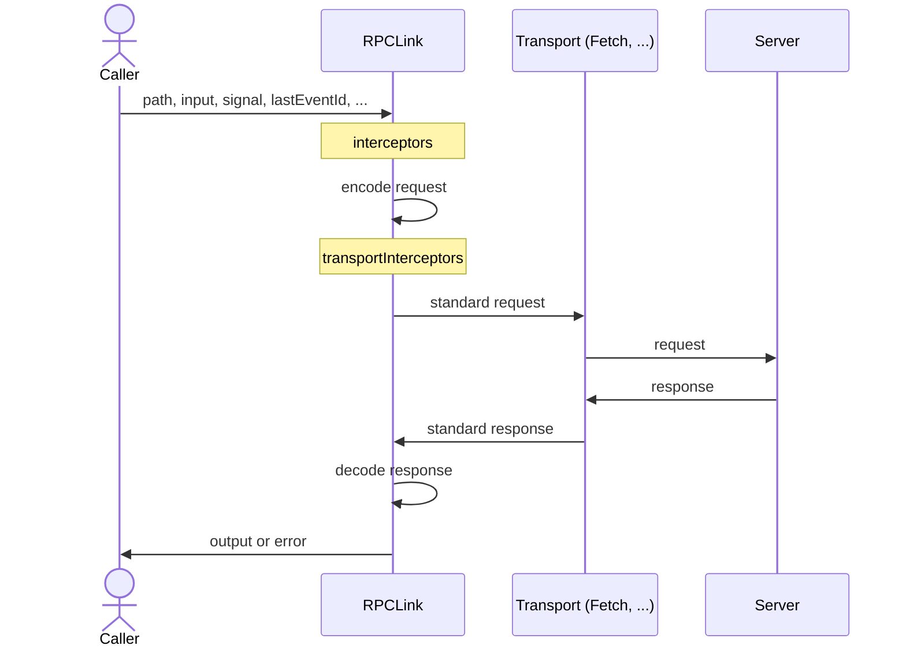

## Overview

`RPCLink` can call any server that implements the [RPC protocol](/docs/rpc/protocol):

```ts
const link = new RPCLink({
  origin: 'https://example.com',
  url: '/rpc',
  headers: ({ context }) => ({
    authorization: `Bearer ${token}`,
  }),
  interceptors: [
    async ({ next, path }) => {
      console.time(path.join('.'))

      try {
        return await next()
      }
      catch (err) {
        console.error(`${path.join('.')}:`, err)
        throw err
      }
      finally {
        console.timeEnd(path.join('.'))
      }
    },
  ],
  plugins: [
    new RetryAfterLinkPlugin(),
  ],
  fetch: (url, init) => { // <- only available in fetch adapter
    return globalThis.fetch(url, {
      ...init,
      credentials: 'include', // Include cookies on cross-origin requests
    })
  },
})

export const client = createORPCClient(link)
```

:::warning
To better support `Blob`, `File`, and `ReadableStream<Uint8Array>` at the root level in cross-origin scenarios,
extend your [CORS allowlist](https://developer.mozilla.org/en-US/docs/Glossary/CORS-safelisted_response_header) to allow clients to read the `Content-Disposition` and `Standard-Server` response headers. Learn more in the [Standard Server documentation](https://github.com/middleapi/standard-server#how-body-parsing-works). If you use the [CORS Plugin](/docs/plugins/cors), include them in `exposeHeaders`:

```ts
const cors = new CORSHandlerPlugin({
  exposeHeaders: ['Content-Disposition', 'Standard-Server'],
})
```

:::

## Typesafe Clients

After you create an `RPCLink`, pass it to `createORPCClient` to build a typesafe client for either a [contract](/docs/contract/router) or a [router](/docs/router):

```ts
import { createORPCClient } from '@orpc/client'
import { RouterContractClient } from '@orpc/contract'
import { RouterClient } from '@orpc/server'

// if you are following contract-first approach
const contractClient: RouterContractClient<typeof contract> = createORPCClient(link)

// if you are following normal approach
const normalClient: RouterClient<typeof router> = createORPCClient(link)
```

## Client Context

Client context lets you pass per-call values, such as auth tokens or cache hints. This context is available in link options, interceptors, plugins, and other extensibility points.

```ts
interface ClientContext {
  token?: string
}

const link = new RPCLink<ClientContext>({
  headers: ({ context }) => ({
    authorization: context?.token ? `Bearer ${context.token}` : undefined,
  }),
  interceptors: [
    async ({ next, context }) => {
      console.log('Client context:', context)
      return await next()
    },
  ],
})
```

:::info
Pass `ClientContext` when creating the client, then provide context on each call as needed:

```ts
// if you are using the contract-first approach
const client: RouterContractClient<typeof contract, ClientContext> = createORPCClient(link)

// if you are using the standard approach
const client: RouterClient<typeof router, ClientContext> = createORPCClient(link)

const output = await client.someProcedure(input, {
  context: {
    token: 'abc123',
  },
})
```

:::

## URL and Header Options

Use `origin`, `url`, and `headers` to control request destination and headers.

- `origin`: Server protocol and domain. Omit in the browser to use the current origin.
- `url`: Usually a path prefix like `/api`. May include query params that are added to every request.
- `headers`: Headers sent with every request, such as auth or trace IDs. Keys should be lowercase.

```ts
const link = new RPCLink({
  origin: 'https://api.example.com',
  url: '/rpc?v=2',
  headers: {
    authorization: `Bearer ${getAuthToken()}`,
  },
})
```

:::info
Each option can also be a function to dynamically customize values per request. For example, routing to a different `origin` based on the procedure path, or injecting headers from client context:

```ts
const link = new RPCLink<ClientContext>({
  origin: ({ path, context }) => {
    if (path[0] === 'internal') {
      return 'https://internal.example.com'
    }

    return 'https://api.example.com'
  },
  headers: ({ context }) => ({
    authorization: context?.token ? `Bearer ${context.token}` : undefined,
  }),
})
```

:::

## Interceptors

Interceptors let you observe or change different stages of an RPC request. Common use cases include logging, retries, auth, batching, and transport customization.

### Interceptors

Interceptors run around the entire call, including input encoding, transport, and response decoding. Use them when you need access to the path, input, output, or error.

```ts
const link = new RPCLink({
  interceptors: [
    async ({ next, path, input }) => {
      console.time(path.join('.'))

      try {
        const output = await next()
        return output
      }
      catch (err) {
        console.error(`${path.join('.')}:`, err)
        throw err
      }
      finally {
        console.timeEnd(path.join('.'))
      }
    },
  ],
})
```

### Transport Interceptors

Interceptors run after input encoding and before response decoding. Use them to inspect or rewrite the request.

```ts
const link = new RPCLink({
  transportInterceptors: [
    async (options) => {
      const response = await options.next({
        ...options,
        request: {
          ...options.request,
          headers: {
            ...options.request.headers,
            'x-request-id': crypto.randomUUID(),
          },
        },
      })

      return response
    },
  ],
})
```

## Plugins

Plugins package reusable interceptors. For example, [Retry After Plugin](/docs/plugins/retry-after) adds retry behavior based on the `retry-after` response header.

```ts
const link = new RPCLink({
  plugins: [
    new RetryAfterLinkPlugin(),
  ],
})
```

## Custom Serializer

`RPCLink` uses a built-in serializer that supports many native types. Provide a custom serializer when you need to extend or override the default behavior. For more details, see [RPC Serializer](/docs/rpc/serializer).

```ts
const link = new RPCLink({
  serializer: new RPCSerializer({
    handlers: {
      // ...custom handlers
    },
  }),
})
```

## Request Method

`RPCLink` sends requests with `POST` by default. Use `method` to choose the method per call.

:::warning
By default, [RPC handlers](/docs/rpc/handler#supported-http-methods) only accept `POST`, `PUT`, `PATCH`, and `DELETE` requests. Before sending `GET` or `QUERY` requests, allow them in the handler first, and understand [the risks of enabling `GET`](/docs/rpc/handler#enabling-the-get-method).
:::

```ts
type ClientContext = {
  cache?: RequestCache
}

const link = new RPCLink<ClientContext>({
  url: '/rpc',
  method: ({ context }, path) => {
    if (context.cache) {
      return 'GET'
    }

    if (path.at(-1)?.match(/^(?:get|find|list|search)(?:[A-Z].*)?$/)) {
      return 'GET'
    }

    return 'POST'
  },
  fetch: (url, init, { context }) => {
    return fetch(url, {
      ...init,
      cache: context.cache,
    })
  },
})
```

## Malformed Responses

When `RPCLink` cannot decode a response, for example when a proxy or gateway answers instead of your handler, it throws a `MalformedResponseError` instead of an `ORPCError`. Its message is inferred from the body or status, and it carries the resolved response:

```ts
import { MalformedResponseError, onError } from '@orpc/client'

const link = new RPCLink({
  interceptors: [
    onError((error) => {
      if (error instanceof MalformedResponseError) {
        console.error('Malformed response:', error.response.status, error.response.body)
      }
    }),
  ],
})
```

## Event Stream Options

Configure how an [AsyncIteratorObject](/docs/async-iterator-object) is streamed to the server. Available options depend on the adapter. For example, the fetch adapter supports:

```ts
const link = new RPCLink({
  toFetchRequest: {
    eventStream: {
      initialComment: {
        /**
         * If true, an initial comment is sent immediately upon stream start to flush headers.
         * This allows the receiving side to establish the connection without waiting for the first event.
         *
         * @default true
         */
        enabled: true,
        /**
         * The content of the initial comment sent upon stream start. Must not include newline characters.
         *
         * @default ''
         */
        comment: '',
      },
      keepAlive: {
        /**
         * If true, a ping comment is sent periodically to keep the connection alive.
         *
         * @default true
         */
        enabled: true,
        /**
         * Interval (in milliseconds) between ping comments sent after the last event.
         *
         * @default 15000
         */
        interval: 15000,
        /**
         * The content of the ping comment. Must not include newline characters.
         *
         * @default ''
         */
        comment: '',
      },
    },
  },
})
```

## Lifecycle

The diagram below shows how a call flows through `RPCLink` and where each interceptor type runs:


