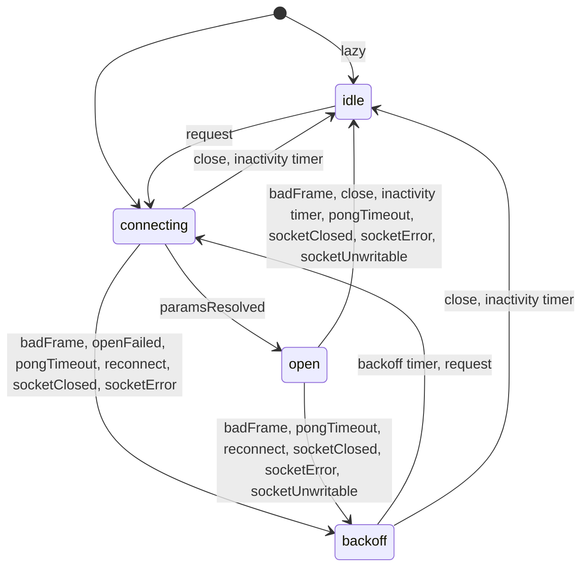
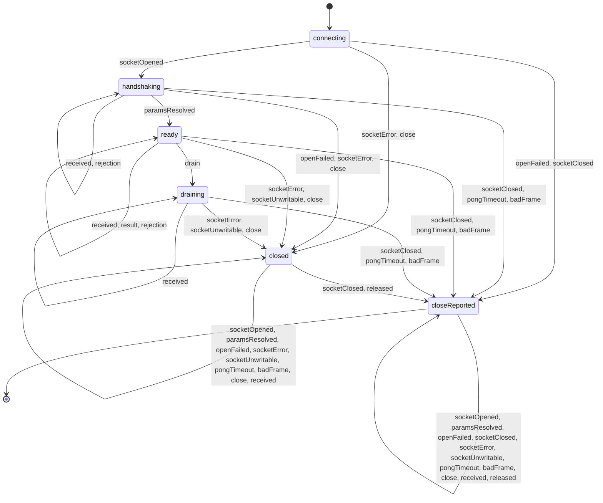
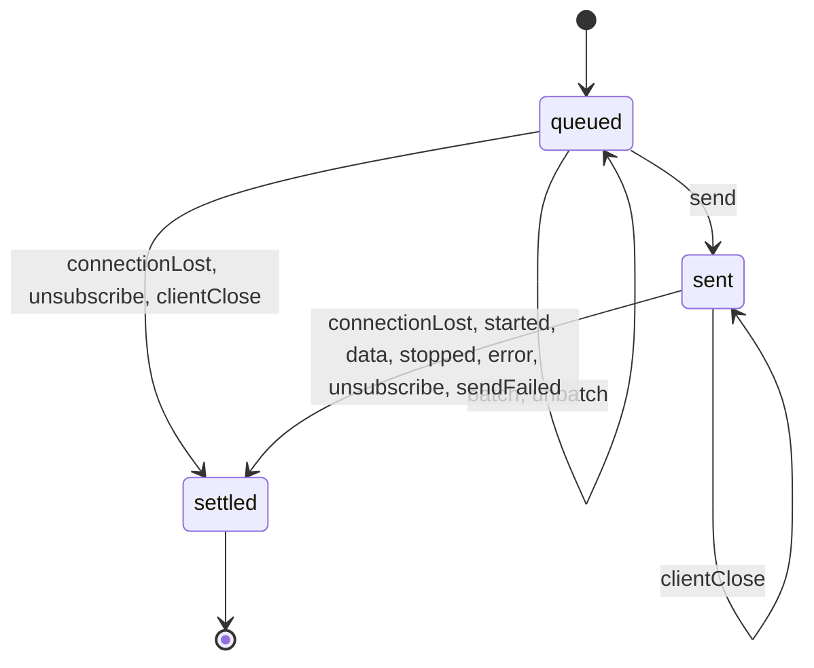
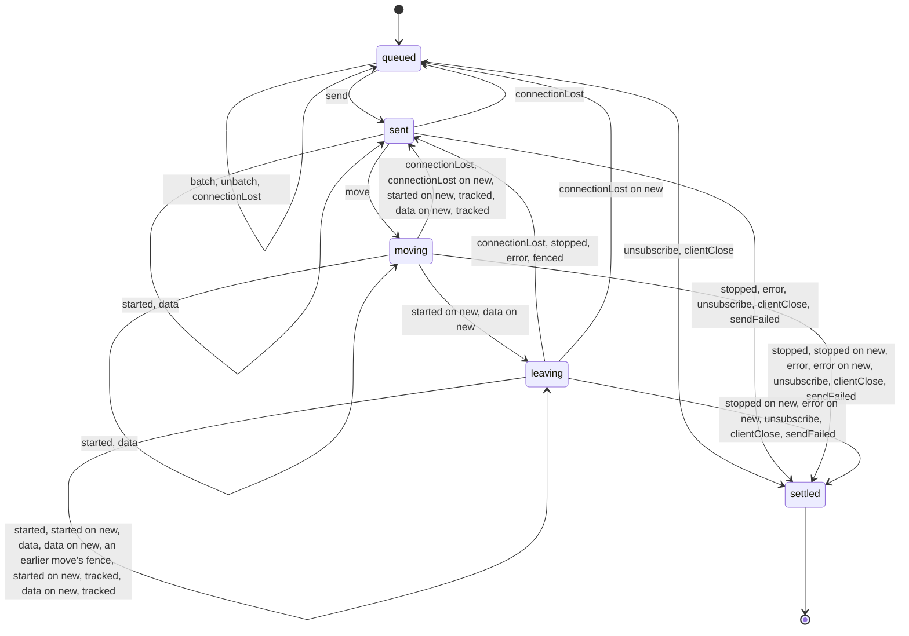

<!-- Generated by websockets.clientMachine.test.ts; update with `pnpm vitest run packages/tests/server/websockets.clientMachine.test.ts -u`. -->

## Client lifecycle

Every lifecycle change the model-based test reaches.

## Connection

## Request: query and mutation

## Request: subscription

