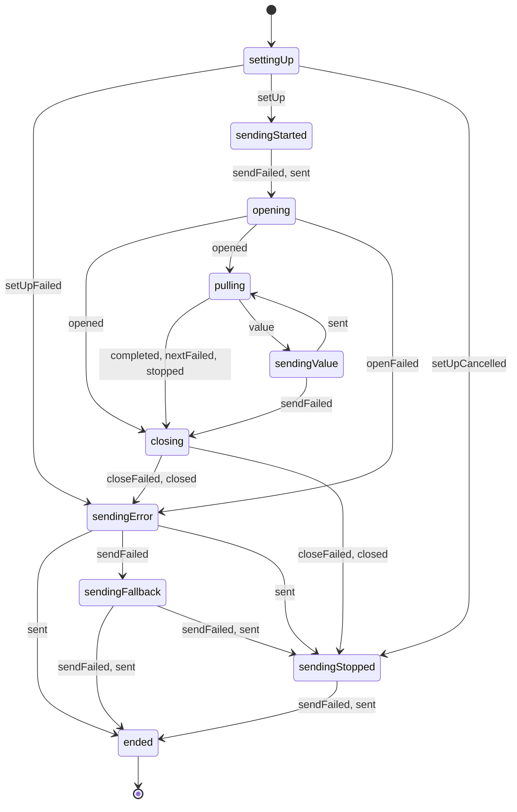
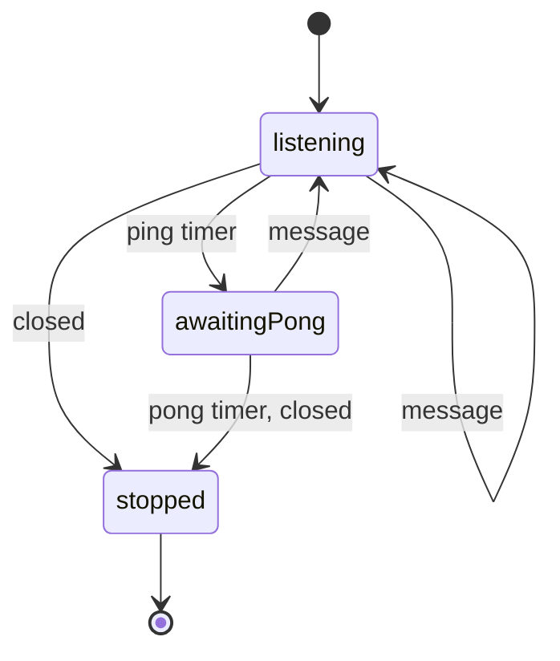

# WebSocket server state machines

Generated by `websockets.serverMachines.model.test.ts`.

## A subscription

Edges reached by the seeded model run. Each event is the outcome of the effect the state waits for.

## keepAlive

